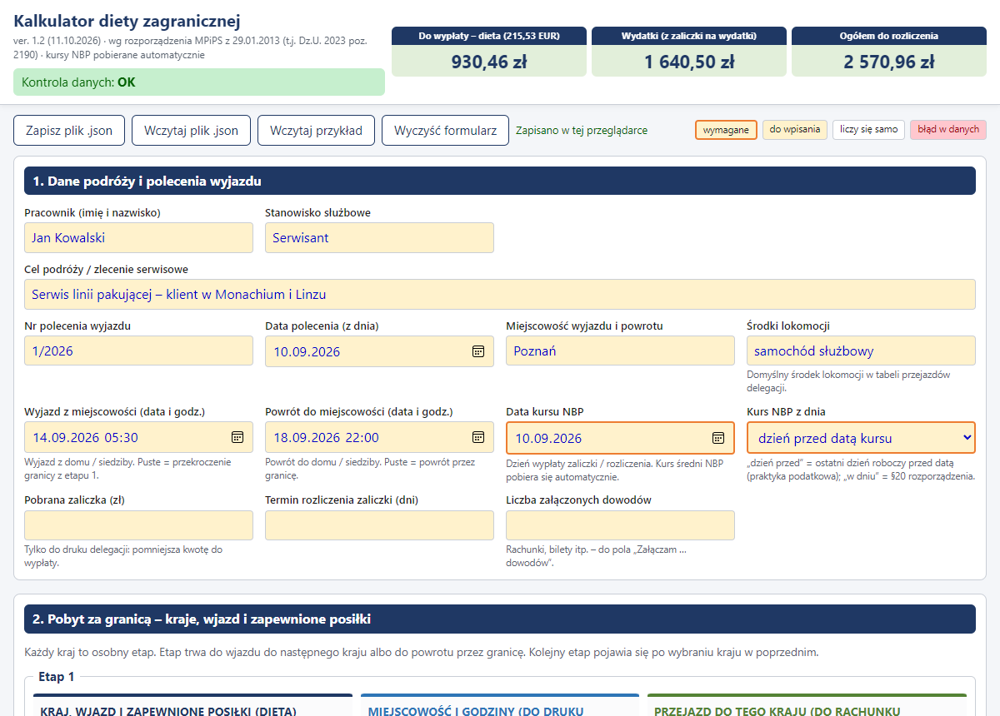
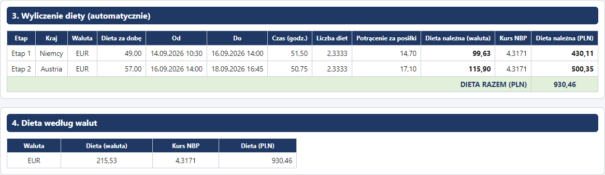
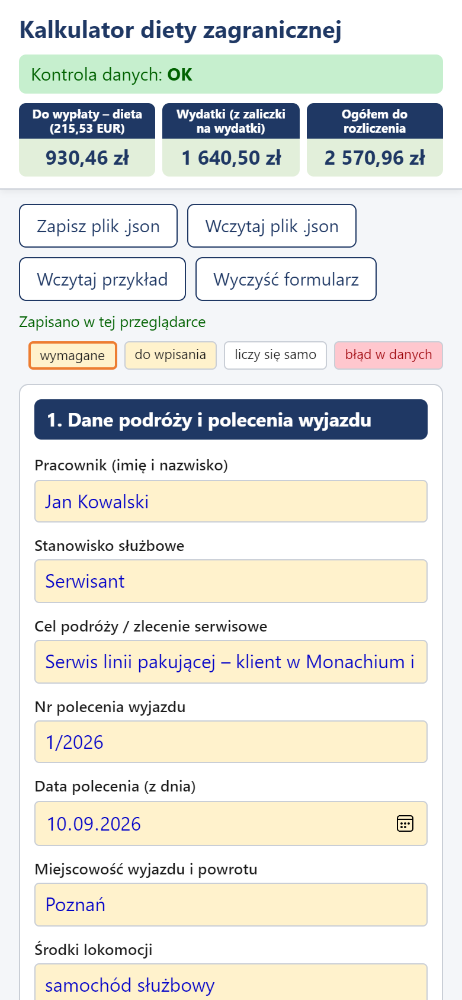
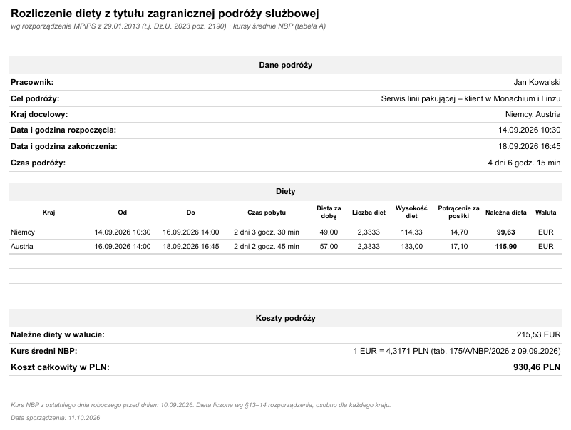
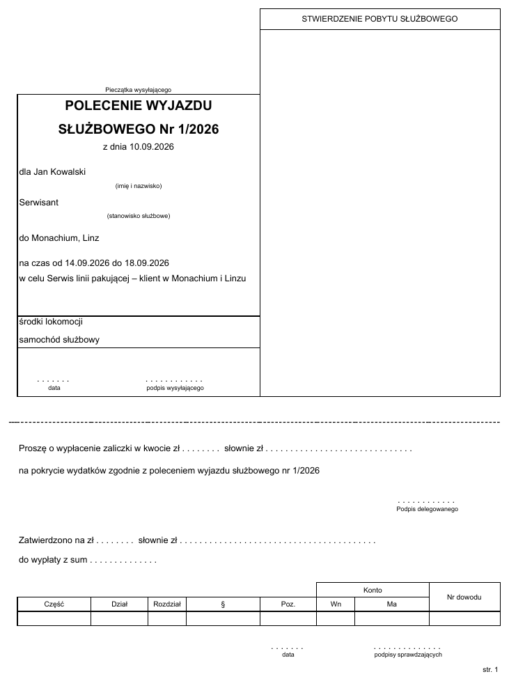
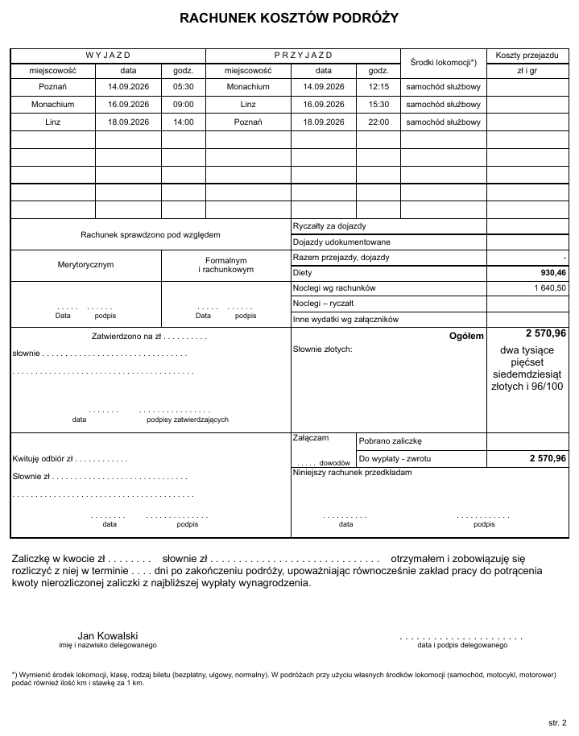

# Kalkulator diety zagranicznej (przeglądarka)

[](https://krystianr84.github.io/delegacja_zagraniczna_js/)
[](https://github.com/krystianr84/delegacja_zagraniczna_js/actions/workflows/testy.yml)
[](https://github.com/krystianr84/delegacja_zagraniczna_js/deployments/github-pages)
[](LICENSE)
[](https://github.com/krystianr84/delegacja_zagraniczna_plus)

Kalkulator diety z tytułu zagranicznej podróży służbowej. Działa w przeglądarce – na komputerze i na telefonie – i wypełnia druk delegacji („Polecenie wyjazdu służbowego” + „Rachunek kosztów podróży”). Powstał dla serwisantów wyjeżdżających za granicę jako wersja [kalkulatora excelowego](https://github.com/krystianr84/delegacja_zagraniczna_plus), która nie potrzebuje Excela.

- **Bez instalacji i bez Excela.** Zwykła strona internetowa – otwierasz link i liczysz, także na telefonie.
- **Wyniki jak w wersji excelowej.** Te same reguły i te same zaokrąglenia – wydruki z obu wersji zgadzają się co do grosza.
- **Kursy NBP pobierane automatycznie** z `api.nbp.pl`: średni kurs z tabeli A z dnia poprzedzającego datę kursu albo z tego dnia. Przy dniu wolnym brany jest ostatni wcześniejszy kurs.
- **Waluta i stawka diety wynikają z kraju.** Dane obejmują 120 państw z załącznika do rozporządzenia.
- **Do 5 krajów w jednej podróży**, dla każdego dieta liczona osobno, z potrąceniami za zapewnione posiłki.
- **Druk delegacji i raport** na A4 – do drukarki albo do PDF.
- **Dane zostają u Ciebie.** Formularz zapisuje się w przeglądarce, a podróż można zapisać do pliku `.json`. Strona niczego nie wysyła poza zapytaniami o kurs do NBP.

## ▶️ Otwórz

**[krystianr84.github.io/delegacja_zagraniczna_js](https://krystianr84.github.io/delegacja_zagraniczna_js/)**

Zawsze najnowsza wersja, nic nie trzeba pobierać. Przycisk **Wczytaj przykład** wypełnia formularz fikcyjnymi danymi („Jan Kowalski”, Niemcy + Austria) – liczby z tego przykładu są rozpisane w sekcji [Przykład krok po kroku](#przykład-krok-po-kroku).

Na telefonie możesz dodać stronę do ekranu głównego (w menu przeglądarki: *Dodaj do ekranu głównego*), żeby mieć ją pod ręką.

## Zrzuty ekranu

**Kalkulator** – dane wpisuje się w żółte pola, wynik jest od razu w kafelkach na górze:



**Wyliczenie diety** – osobno dla każdego kraju, z kursem NBP:



| Telefon | Raport | Delegacja – str. 1 | Delegacja – str. 2 |
|---|---|---|---|
|  |  |  |  |

## Wymagania

- **Aktualna przeglądarka**: Chrome, Edge, Firefox albo Safari – na komputerze, telefonie lub tablecie.
- **Dostęp do internetu** (api.nbp.pl), żeby pobrać kurs. Bez niego można wpisać kurs ręcznie (szczegóły w sekcji [Problemy i rozwiązania](#problemy-i-rozwiązania)).

## Jak używać

1. Otwórz [stronę kalkulatora](https://krystianr84.github.io/delegacja_zagraniczna_js/) i wypełnij żółte pola (pomarańczowa ramka = pole wymagane):
   - **sekcja 1** – pracownik, cel, nr i data polecenia, wyjazd i powrót do miejscowości, **data kursu NBP**;
   - **sekcja 2** – kolejne kraje z chwilą przekroczenia granicy (samolot: start z ostatniego lotniska w kraju), liczbą zapewnionych posiłków, miejscowością i kosztami przejazdu. Kolejny etap pojawia się po wybraniu kraju. Na końcu wpisz **powrót przez granicę** PL (samolot: lądowanie);
   - **sekcja 5** – ryczałty, noclegi i inne wydatki (kwoty w walutach obcych przeliczają się po kursie NBP).
2. **Kontrola danych** u góry strony pokazuje `OK` albo opis błędu, a pole z błędem podświetla się na czerwono. Kafelki pokazują dietę do wypłaty, wydatki i kwotę ogółem do rozliczenia.
3. W sekcji **6. Druk** kliknij **Drukuj delegację** (2 strony) albo **Drukuj raport** (1 strona). W oknie drukowania wybierz drukarkę albo **Zapisz jako PDF**. *Podgląd wydruku* pokazuje kartki przed drukiem.
4. **Zapisz plik .json**, jeśli chcesz zachować podróż na później albo przenieść ją na inne urządzenie. **Wczytaj plik .json** otwiera ją z powrotem.

## Problemy i rozwiązania

**Kontrola pokazuje „Brak kursu NBP” albo kurs się nie pobiera**
1. Sprawdź **datę kursu**. Kurs z przyszłej daty jeszcze nie istnieje – NBP publikuje kursy w dni robocze, około południa.
2. Kliknij **Pobierz kursy ponownie** w sekcji *Kursy NBP*. Obok przycisku pojawia się opis błędu (np. brak połączenia).
3. Otwórz w przeglądarce <https://api.nbp.pl/api/exchangerates/tables/a/>. Jeśli strona się nie otwiera, a internet działa, sieć firmowa (proxy, zapora) blokuje NBP. Poproś dział IT o dostęp do `api.nbp.pl` albo **wpisz kurs ręcznie** (niżej).

**Kurs ręczny – gdy kursy nie pobierają się wcale**
W sekcji **Kursy NBP**, przy właściwej walucie, wpisz: **kurs ręczny**, **datę notowania** i **nr tabeli** (np. `4,3789`, `08.10.2026`, `196/A/NBP/2026`). Kurs średni z tabeli A znajdziesz na [nbp.pl – tabela A](https://nbp.pl/statystyka-i-sprawozdawczosc/kursy/tabela-a/) (można wybrać datę notowania). Wpisany kurs zastępuje kurs z NBP w diecie, kosztach, Raporcie i Delegacji, a kolumna „Źródło kursu” pokazuje „wpisany ręcznie”. Datę i nr tabeli trzeba podać, bo Raport je drukuje. Żeby wrócić do kursu pobieranego automatycznie, usuń wpisany kurs ręczny.

**Dane zniknęły po zamknięciu przeglądarki**
Formularz zapisuje się w tej przeglądarce na tym urządzeniu. W trybie prywatnym (incognito) dane znikają po zamknięciu okna, a po wyczyszczeniu danych przeglądania – także w zwykłym. Gdy przeglądarka w ogóle blokuje zapis, obok przycisków pojawia się ostrzeżenie. Używaj **Zapisz plik .json**, a przy następnej wizycie **Wczytaj plik .json**.

**Chcę dokończyć podróż na innym komputerze albo telefonie**
Zapisz plik `.json` (**Zapisz plik .json**), prześlij go sobie (mail, komunikator, dysk) i otwórz na drugim urządzeniu przyciskiem **Wczytaj plik .json**.

**Na wydruku jest data, tytuł albo adres strony**
To nagłówki i stopki przeglądarki. Chrome i Edge ich nie drukują – strona nie zostawia na nie miejsca na kartce. Jeśli widzisz je w innej przeglądarce, w oknie drukowania rozwiń *Więcej ustawień* i odznacz **Nagłówki i stopki**. Ustaw format **A4** i skalę **100%** (domyślna).

**Jak zrobić PDF na telefonie?**
Kliknij **Drukuj delegację** albo **Drukuj raport**. Na Androidzie wybierz drukarkę **Zapisz jako PDF**, na iPhonie w oknie drukowania użyj **Udostępnij → Zachowaj w Plikach**.

**Kafelki wyniku pokazują „—”**
Kontrola danych nie jest `OK`. Przeczytaj komunikat u góry strony i popraw pole podświetlone na czerwono. Najczęstsze przyczyny: brak daty wjazdu albo powrotu, pusty etap między krajami, etapy nie po kolei, więcej posiłków niż dni pobytu w kraju.

**Jak wpisać podróż samolotem?**
Jako wjazd do kraju wpisz godzinę **startu** samolotu z ostatniego lotniska w Polsce, a jako powrót – godzinę **lądowania** na pierwszym lotnisku w Polsce (§12 rozporządzenia).

**Byłem w kilku krajach**
Każdy kraj to osobny etap w sekcji 2, wpisany w kolejności podróży. Etap trwa od wjazdu do danego kraju do wjazdu do następnego, a ostatni – do powrotu przez granicę PL. Nie zostawiaj pustych etapów między krajami.

**Co wpisać w posiłkach?**
Liczbę śniadań, obiadów i kolacji **zapewnionych** w danym kraju (np. śniadania w cenie hotelu, obiady u klienta). Każdy posiłek pomniejsza dietę o 15% (śniadanie) albo 30% (obiad, kolacja) stawki dziennej.

**Jak usunąć przykładowe dane?**
Kliknij **Wyczyść formularz** (dwa razy – drugie kliknięcie potwierdza).

**Kalkulator nie liczy diety krajowej, kilometrówki ani ryczałtów**
Tak, to celowe. Liczona jest tylko dieta zagraniczna. Pozostałe koszty wpisuje się gotowymi kwotami w sekcji 5 – trafiają na druk delegacji i do kwoty ogółem.

## Zasady obliczeń

Rozporządzenie MPiPS z 29.01.2013 w sprawie należności przysługujących pracownikowi z tytułu podróży służbowej (t.j. Dz.U. 2023 poz. 2190), stawki obowiązujące od 29.11.2022:

| Przepis | Reguła |
|---|---|
| §12 – czas | Od przekroczenia granicy w drodze za granicę do przekroczenia jej w drodze powrotnej (samolot: start – lądowanie). Etap kończy się wjazdem do kolejnego kraju. |
| §13 – dieta | Za każdą pełną dobę 100%; niepełna doba: do 8 h – 1/3, ponad 8 do 12 h – 1/2, ponad 12 h – 100%. Liczona osobno dla każdego kraju. |
| §14 – posiłki | Śniadanie −15%, obiad −30%, kolacja −30% diety dziennej. Dieta nie spada poniżej zera. |
| §20 – kurs | Średni kurs NBP (tabela A) z dnia poprzedzającego datę kursu albo z dnia daty kursu (do wyboru). Przy dniu wolnym – ostatni wcześniejszy kurs. |

### Przykład krok po kroku

Dane z przycisku **Wczytaj przykład**: wyjazd samochodem do Monachium i Linzu, 2 śniadania w hotelu w każdym kraju, data kursu 10.09.2026, kurs z dnia poprzedniego.

| | Niemcy | Austria |
|---|---|---|
| Wjazd do kraju | 14.09.2026 10:30 | 16.09.2026 14:00 |
| Koniec etapu | 16.09.2026 14:00 (wjazd do Austrii) | 18.09.2026 16:45 (powrót przez granicę PL) |
| Czas pobytu | 51 h 30 min = 2 doby + 3 h 30 min | 50 h 45 min = 2 doby + 2 h 45 min |
| Liczba diet (§13) | 2 + ⅓ (reszta do 8 h) | 2 + ⅓ (reszta do 8 h) |
| Dieta za dobę | 49 EUR | 57 EUR |
| Wysokość diet | 49 × 2⅓ = 114,33 EUR | 57 × 2⅓ = 133,00 EUR |
| Potrącenie za posiłki (§14) | 2 śniadania × 15% × 49 = 14,70 EUR | 2 śniadania × 15% × 57 = 17,10 EUR |
| **Należna dieta** | **99,63 EUR** | **115,90 EUR** |
| Kurs NBP | 4,3171 (tab. 175/A/NBP/2026 z 09.09.2026) | 4,3171 |
| **Dieta w PLN** | 99,63 × 4,3171 = **430,11 PLN** | 115,90 × 4,3171 = **500,35 PLN** |

Dieta razem: 215,53 EUR = **930,46 PLN**. Do tego noclegi 380 EUR × 4,3171 = 1 640,50 PLN, więc ogółem do rozliczenia **2 570,96 PLN**. Kwoty w PLN są liczone i zaokrąglane osobno dla każdego kraju – dokładnie tak jak w wersji excelowej.

**Przypadek kontrolny**: Węgry, 28.09.2026 12:00 → 02.10.2026 16:00, bez posiłków, kurs z 08.10.2026 → **4 dni 4 godz. 0 min, 190,67 EUR, 834,92 PLN** (kurs 4,3789, tabela 196/A/NBP/2026).

**Aktualność stawek:** stawki diet i limity noclegów są w pliku [`dane/kraje.json`](dane/kraje.json) – te same co w wersji excelowej. Po zmianie przepisów wystarczy go poprawić; strona od razu liczy według nowych stawek. W 2026 r. był projekt podwyżki stawek – sprawdź, czy weszła w życie.

## Zgłoś błąd albo pomysł

Kalkulator liczy inaczej, niż powinien, strona nie działa albo masz pomysł na zmianę? [Załóż zgłoszenie](https://github.com/krystianr84/delegacja_zagraniczna_js/issues/new) – napisz, co wpisano, co wyszło i czego się spodziewano (najlepiej z przeglądarką i urządzeniem). Nie wpisuj w nim imion, nazwisk ani numerów poleceń, wystarczą kraje, daty i kwoty. Możesz też dołączyć plik `.json` podróży po usunięciu z niego danych osobowych.

## Dla programistów

Bez frameworka, bez zależności i bez kroku budowania: HTML, CSS i moduły ES. Logika to czyste funkcje w `web/lib/`, testowane przypadkami z wersji excelowej; druk porównano z PDF-em wyeksportowanym z arkusza (te same teksty i kwoty, układ w granicach ~2 mm).

```
web/
  index.html, app.js, style.css   formularz i widok (app.js tylko łączy pola z web/lib/)
  lib/round.js       ROUND / ROUNDUP zgodne z Excelem (15 cyfr znaczących, połówki od zera)
  lib/obliczenia.js  dieta, kontrola danych, koszty w PLN, kwota słownie
  lib/nbp.js         kursy NBP: zapytanie, 404/400, cache w localStorage, kurs ręczny
  lib/druk.js        Delegacja i Raport (teksty jak formuły arkuszy + układ komórek)
  lib/zapis.js       plik .json i autozapis
  lib/format.js, lib/model.js
dane/kraje.json      120 państw: [nazwa, waluta, dieta, limit noclegu]
test/                testy obliczeń (node --test)
narzedzia/serwer.js                podgląd lokalny
narzedzia/sprawdz-przegladarke.mjs testy strony w Chrome / Edge (bez okna)
.github/workflows/   testy przy każdym pushu, co tydzień test na żywym NBP
docs/                zrzuty ekranu do README
```

```sh
npm test                     # obliczenia: node --test   (Node 20+)
npm run test:przegladarka    # strona w Chrome / Edge bez okna (CHROME=ścieżka – inna przeglądarka)
NBP_LIVE=1 node --test       # dodatkowo test na żywym api.nbp.pl
npm start                    # podgląd: node narzedzia/serwer.js → http://localhost:8080/web/
```

**Testy strony** uruchamiają przeglądarkę bez okna i przechodzą przez formularz jak użytkownik: przykład i przypadek kontrolny, błędy w danych, druk Delegacji i Raportu do PDF (liczba stron, A4, brak nagłówków przeglądarki), autozapis, zapis i import pliku, brak połączenia z NBP i kurs ręczny, widok telefonu. Zapytania do `api.nbp.pl` są przechwytywane i obsługiwane prawdziwymi notowaniami zapisanymi w skrypcie, więc wynik nie zależy od sieci.

**GitHub Actions**: przy każdym pushu i pull requeście `testy` (obliczenia + strona w Chrome); w każdy poniedziałek `nbp-na-zywo` sprawdza, czy api.nbp.pl zachowuje się tak, jak zakłada `web/lib/nbp.js`.

Moduły ES nie działają z `file://`, więc do podglądu potrzebny jest serwer (wystarczy dowolny serwer plików statycznych uruchomiony w katalogu głównym repozytorium).

**Kolejność zaokrągleń** dla każdego etapu: czas w minutach zaokrąglony do pełnej minuty → liczba diet → potrącenie za posiłki `ROUND(…; 2)` → dieta w walucie `MAX(0; ROUND(…; 2))` → dieta w PLN `ROUND(dieta × kurs; 2)` osobno dla etapu; dieta razem to suma kwot etapów.

**Publikacja**: GitHub Pages z gałęzi `main`, katalog główny (`/`) – każdy push na `main` aktualizuje stronę. `index.html` w katalogu głównym przekierowuje na `web/`; strona czyta `../dane/kraje.json`.

## Zastrzeżenie

Narzędzie pomocnicze, bez gwarancji poprawności wyliczeń. Przed wypłatą sprawdź wynik z obowiązującymi przepisami i regulaminem podróży w Twojej firmie. Projekt nie jest powiązany z NBP.

## Licencja

Kalkulator (strona, kod w `web/`, testy i dokumentacja) jest udostępniony na licencji **MIT** – zobacz [`LICENSE`](LICENSE). Możesz go używać, kopiować, zmieniać i rozpowszechniać, także w firmie i komercyjnie, pod warunkiem zachowania informacji o autorze i treści licencji. Oprogramowanie jest dostarczane „tak jak jest”, bez żadnej gwarancji.

Stawki diet pochodzą z rozporządzenia (akt prawny – nie podlega prawu autorskiemu).
